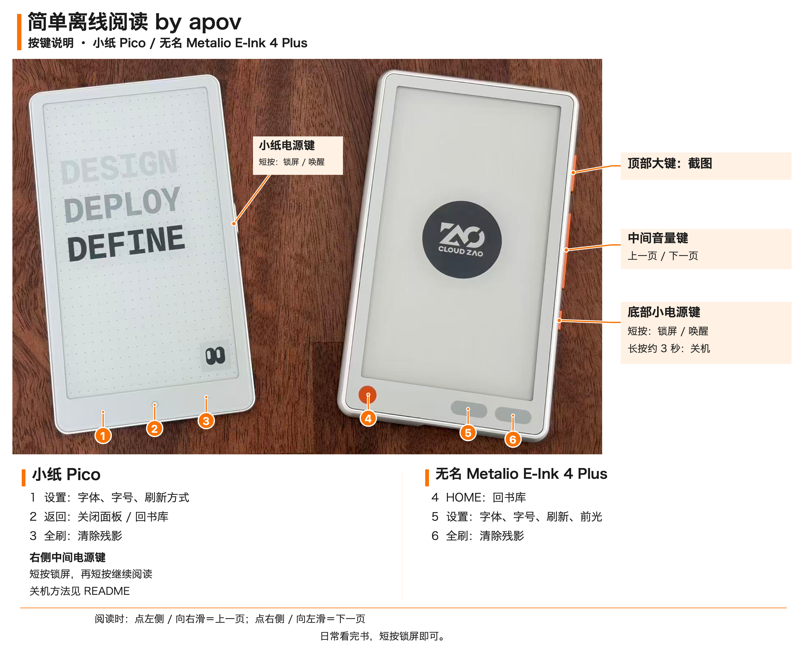

# 简单离线阅读 by apov

> **刷机风险与免责声明**
>
> 这是按作者个人习惯定制、免费分享的自由软件（free software），不是经过完整测试的商业产品，**可能存在大量已知或未知 bug**。软件按“现状”（AS IS）提供，不保证稳定性、兼容性、安全性或适合任何特定用途。
>
> **刷机完全自愿，风险由使用者自行承担**，包括但不限于数据丢失、无法开机、屏幕异常及设备损坏。请先核对硬件、备份数据，并具备自行恢复原固件的能力；无法接受风险就不要刷。
>
> 在适用法律允许的范围内，作者及贡献者不对使用或无法使用本软件造成的损失承担责任。作者不提供保修、售后、远程救砖、维修或赔偿承诺，也不承诺持续维护或回复问题。相关条款以随附许可证为准，参见 [Apache-2.0 第 7、8 条](https://www.apache.org/licenses/LICENSE-2.0)。

这是一份“超个性化固件”的实践：分享的是 **apov 自己的版本**，不是适合所有人的标准答案。你可以在遵守许可证和保留署名的前提下，fork 源码、修改界面与功能，做成自己的版本。作者个人开发暂告一段落，后续改进交给感兴趣的社区开发者，不承诺开发路线或支持服务。

给墨水屏设备做一个安静、直接的离线 EPUB 阅读器。开机进入书库，点开就读；自己的书和字体由自己管理。

当前适配 **小纸 Pico** 与 **Metalio E-Ink 4 Plus**（本文也称“无名”）。两款设备共用阅读界面和排版逻辑，硬件驱动与刷机包分别提供。名称用于本项目介绍，固件内部仍保留原有项目标识。

本项目基于 [MindReset/read_pico_firmware](https://github.com/MindReset/read_pico_firmware) 开发，Metalio 板级适配使用 [CloudZao/Metalio-E-INK4-Plus](https://github.com/CloudZao/Metalio-E-INK4-Plus) 的相关开源驱动。感谢原作者和社区。

## 下载前先选对设备

| 下载包 | 适用范围 | 芯片 |
| --- | --- | --- |
| `simple-offline-reading-pico-2026.11.18-preview.zip` | 小纸 Pico，16 MB Flash；使用该板原有 Flash 高性能模式与时序配置 | ESP32-S3 |
| `simple-offline-reading-metalio-2026.11.18-preview.zip` | Metalio E-Ink 4 Plus，有双色温前光、无 4G／摄像头的已测试配置；接线配置 `plus-xstl4-mode19`，屏幕 VCOM 参数 **1200 mV** | ESP32-S31 |
| `simple-offline-reading-source-2026.11.18-preview.zip` | 两个机型共用的源码、构建配置、书籍整理工具与文档 | — |

两机的 BIN **不能互刷**。Metalio 并非适配所有 PCB 版本；版本号相同也不能代替接线和面板参数核对。其他 VCOM 参数或不同接线的设备需要按原厂资料重新配置、编译，不能直接使用此 Metalio BIN。

这是预览版本。Metalio 的阅读、按键、短按锁屏唤醒、各档前光短时观察、中文字体名和两款外部字体切换已经实测；续航、长时间稳定性和软件关机尚未完成系统验证。小纸本次新版已刷入并确认启动与 SD 读取正常，用户确认翻页和锁屏正常；软件关机入口与关机画面尚待实机验收。完整合并镜像完成了文件校验，网页刷写整个分享包尚未实测。Cloud Zao 标志和书籍封面已由用户确认显示正常；此次移除锁屏说明、统一“已关机”画面的更新已重新编译并通过睡眠回归及模拟器预览；Metalio 已安装，用户确认封面无遮挡、短按唤醒正常、长按后显示“已关机”。

## 有哪些功能

- 本地 EPUB 书库，显示书名、作者、年份和阅读进度。
- 触屏点击／滑动翻页，自动保存阅读位置。
- 字号、外部 TTF 字体和三档刷新方式；手动全刷。
- 中文行首／行尾禁则、标点挤压与两端对齐，英文断词与词距调整。
- 预处理后的书籍封面可用于阅读时锁屏。
- 内置阅读字体和《红楼梦》《西游记》，不插卡也能开始阅读。
- Metalio 额外支持音量键翻页、双色温前光和截图。

当前主阅读器以 EPUB 文字阅读为主，跳过纯图片章节。源码保留上游的一些演示应用，但不代表这些功能已在两个机型上完成适配。

## 让 Agent 协助刷机（推荐）

把对应固件 ZIP 解压，让能访问本机文件与 USB 的 Agent（如 Codex／Claude Code）协助识别设备、校验文件、备份和安装。可复制的任务说明、遇到意外时的停止条件及隐私要求见 [Agent 刷机指南](docs/AGENT_FLASHING.md)。Agent 不能保证救砖，也不能替你确认未知硬件参数。

## 自行网页刷机

解压对应设备包，先阅读包内 `FLASHING.md`。

1. 使用有数据传输功能的 USB 线和支持 Web Serial 的 Chrome／Edge，连接处于可下载状态的设备。
2. 小纸可参照 [厂商官方连接说明](https://dot.mindreset.tech/docs/read_0/firmware)，并使用 [Espressif 芯片厂商通用网页烧录工具](https://espressif.github.io/esptool-js/)。Metalio 可从 [CloudZao 固件仓库](https://burner.cloudzao.com/zh/registry) 选择 **Metalio E-Ink4 Plus → 烧录本地固件**；工具必须正确识别 **ESP32-S31**。不支持 S31 或识别为 P4 时不要继续。
3. 首次安装选择包中的 `*-full.bin`，写入起始地址为 **`0x0`**。它已合并启动程序、分区表、阅读程序和内置内容，不能再把它填到 `0x10000`。
4. 等待写入与校验完成，再断开网页连接。不要同时开串口日志工具。

**完整镜像会覆盖设备原固件、机内设置、阅读进度和机内书籍**，包括旧固件的内部数据；SD 卡不在这个镜像内，不会被格式化。刷写前自行备份需要保留的内容。

已安装本项目、且分区布局相同的设备，才可将 `*-app.bin` 单独写到 **`0x10000`**，保留机内存储和设置。首次从其他固件迁移不能只刷 app。包内附有 SHA-256 校验和、芯片型号和镜像组成清单。

网页工具是否支持当前芯片取决于它部署的版本。这里只交付标准原始 BIN；不宣称所有网页刷机工具均兼容。命令行替代步骤见各设备包的 `FLASHING.md`。

## 日常使用

SD／TF 卡采用设备支持的 FAT 文件系统，文件放在卡根目录的这两个文件夹中：

```text
books/       放 EPUB
fonts/       放 TTF（TrueType 轮廓）
screenshots/ Metalio 截图自动保存到这里
```

主书库不递归搜索任意子文件夹。字体支持中文文件名，不支持 OTF/CFF、TTC、WOFF；菜单最多展示 6 个字体，含“内置”。名称过长会缩短显示。



合照由作者提供，说明图使用标准中文字体排版。按键功能以本版本为准，关机的详细步骤见下文。

| 操作 | 小纸 Pico | Metalio E-Ink 4 Plus |
| --- | --- | --- |
| 正面左触摸键 | 设置 | 返回书库 |
| 正面中触摸键 | 返回／关闭面板 | 字体、字号、刷新、前光设置 |
| 正面右触摸键 | 全刷 | 全刷 |
| 电源键短按 | 锁屏；再次按下恢复 | **侧面最下小键**：锁屏／唤醒 |
| 音量键 | — | 上一页／下一页 |
| 侧面最上较大键 | — | 截图 |

### 日常使用：看完书，短按电源键就好

**两台设备都可以短按锁屏，再短按继续阅读。日常不用进入睡眠菜单，也不必每次都关机。** 锁屏会保存阅读位置，显示书籍封面或默认图片；无名还会关闭前光。

“锁屏”说的是屏幕显示什么，“休眠／关机”说的是机器在后台怎样省电。墨水屏不通电也能保留图片，所以看到封面不代表机器一直在运行，看到一张不动的图也不代表死机。

### 小纸 Pico：默认就用现在的短按方式

小纸默认使用菜单里的 **“深睡 Deepsleep”**。之前说明中提到的“软休眠”，在这款固件里也是指这个默认模式：主要处理器停止供电，负责检测电源键的小电路仍工作。再短按电源键，设备重新启动并恢复阅读，因此需要等几秒。

下面三个选项是**小纸睡眠菜单的选项**，不是要求用户每天做的选择：

| 菜单名称 | 可以怎样理解 | 下次怎么继续 | 什么时候用 |
| --- | --- | --- | --- |
| 浅睡 Lightsleep | 机器暂停工作，但保留运行状态，通常恢复较快；主要处理器仍保持供电 | 短按电源键 | 想试更快恢复时使用；通常比默认模式更耗电，续航差异未实测 |
| 深睡 Deepsleep（默认） | 主要处理器断电，保留少量电路等你按键；不是“更深的一层锁屏” | 短按电源键，等几秒恢复阅读 | **日常推荐保持这个默认选项** |
| 关机 Off | 主要处理器同样断电，但改用较长的按键动作开机，并显示“已关机”画面 | 长按电源键约 1 秒，松开后等待启动 | 想明确关机、减少误按开机时使用；不代表电池完全断开，也没有测得比默认模式省多少电 |

**小纸需要关机时，请使用下面的睡眠菜单入口。** 两台设备的关机操作不同。

如果确实想让小纸关机：

1. 回到书库，长按**正面中间触摸键**，打开演示菜单。
2. 进入“睡眠与唤醒”，选择“关机 Off”，再点“试睡 Try”。“试睡”是这个旧菜单里立即执行所选模式的按钮；此时执行的就是关机。
3. 成功时留下电源图标和“已关机”；如果出现“关机未完成”，说明请求失败。

**选择“关机 Off”会被记住，并改变以后短按锁屏的行为，不只是关这一次。** 下次长按电源键约 1 秒开机后，如果想恢复原来的“短按锁屏、短按继续”，请再次进入该菜单，选回 **“深睡 Deepsleep”**。选中就会保存，不必再点“试睡”。拿不准时，不改这个菜单即可。

### 无名 Metalio：底部小键负责锁屏和关机

- **短按侧面最下面的小电源键**：锁屏；再短按继续阅读。锁屏采用浅睡，保留运行状态。
- **长按同一个键约 3 秒**：请求关机，留下电源图标和“已关机”。若显示“关机未完成”，说明机器仍在运行。
- **关机后再使用**：长按底部小电源键约 2 秒，松开后等待启动。顶部较大的键是截图键，不是电源键。

无名不需要按小纸的演示菜单步骤操作。前光可选关／低／中／高及冷／中／暖；锁屏熄灯，唤醒恢复之前的设置。

两机都在断电前画好“已关机”留屏。异常强制断电可能来不及换图；这些文字帮助区分正常操作，不能用来测量机器是否彻底断电。待机电量和长期续航尚未系统测量。

## 自己整理书籍 metadata 和锁屏封面

阅读器不会替你核对作者、出版年份或下载文件的信息。建议先在电脑处理，再拷到卡里。完整说明见 [书籍与封面准备指南](docs/BOOK_PREPARATION.md)。

### 书库显示信息的优先级

| 字段 | 优先读取 | 没有时使用 |
| --- | --- | --- |
| 书名、作者 | EPUB 内的书目信息（OPF metadata） | 文件名 `书名 - 作者 (年份).epub` |
| 年份 | 文件名括号里的年份 | EPUB 的日期字段 |

因此，只改文件名不一定能修正错误书名／作者；需要同步修改 EPUB 的 metadata。年份优先取文件名，是为了避免把电子版制作日期误当出版年份。

### 推荐流程

先下载源码，以下命令在源码根目录运行。需要 Python 3.10+；安装 Pillow 用于图片转换：

```bash
python3 -m pip install Pillow
python3 tools/prepare_books.py scan "原书文件夹" -o plan.json
```

打开 `plan.json`，逐本核对并修改 `title`（书名）、`author`（作者）、`year`（年份）。标记“请确认”的建议尤其需要人工判断；脚本不会联网查询，也不会调用 AI。保留 `source` 原文件路径，需要跳过某本时增加 `"skip": true`。

确认后输出到**不同于原书目录的新文件夹**：

```bash
python3 tools/prepare_books.py apply plan.json -o "整理好的书"
```

脚本会写入 metadata，将文件名统一为 `书名 - 作者 (年份).epub`，并从书中找到封面生成锁屏缓存。检查终端是否有“失败”“书里没找到封面”或“封面图转不了”；不要只看退出状态。输出同名书会覆盖同一输出文件，所以每次使用新目录，并检查书名重复。

把生成的新 EPUB 放到卡上的 `books/`，不要把 `plan.json` 放进去。测试成功后再移走旧版本，避免书库重复。阅读位置按文件标识保存，重命名或替换 EPUB 后不保证沿用旧进度。

### 锁屏封面必须预处理

普通 EPUB 封面图片并不会直接成为本固件的锁屏图。上述 `apply` 步骤会在 EPUB 内加入：

```text
pico/cover.4bpp
```

这个内部路径在两台设备上相同，并不表示 Metalio 用错了固件。图像为竖向 **684 × 1216、16 级灰度、415872 字节**，两个像素打包到一个字节，左像素占低四位；ZIP 条目不压缩。工具保持图片比例，居中留白，不需要用户手工编码。

如果 EPUB 没有封面，先用自己的 EPUB 编辑工具添加并正确标记封面，再重新运行 `scan` 和 `apply`。建议用 JPG／PNG 原图。只把 JPG 放进卡根目录、改扩展名，或仅在 EPUB 中换一张普通封面图，都不会自动更新锁屏缓存。

打开整理后的书，等页面空闲片刻，再锁屏即可显示封面。没有有效缓存、或在书库锁屏时使用默认图，不叠加操作说明。Metalio 无书籍封面时使用白底Cloud Zao 标志默认锁屏，见[实际渲染预览](docs/images/metalio-lock.png)；小纸保留原默认图。默认锁屏图与关机画面属于固件资源，当前没有从 SD 卡更换全局壁纸的入口。

## 开源字体

内置阅读字体 **Pico Hei** 与界面字体 **Read Pico UI** 均来自 [寒蝉端黑体 ChillDuanSans — Warren2060](https://github.com/Warren2060/ChillDuanSans)，使用 **SIL Open Font License 1.1**。本项目对其做了子集化／字重处理并改名，保留原作者声明和许可证。

- [字体上游及下载](https://github.com/Warren2060/ChillDuanSans/releases)
- [随包的 OFL 许可证](builtin/storage/fonts/OFL.txt)
- [内置阅读字体与书籍来源](builtin/README.md)
- 原字体许可还列出 [Source Han Sans](https://github.com/adobe-fonts/source-han-sans) 与 [Figtree](https://github.com/erikdkennedy/figtree) 的归属。

源码包包含制作内置字体所用的开源原字体；设备使用者另行放入 SD 卡的字体不属于本项目发布内容，分享前请自行核对其许可。

## 已确认的问题与修复

以下是对继续开发有用的结论，不是完整调试记录。代码缺陷的确认与某种硬件现象的唯一根因不是一回事。

| 问题／现象 | 确认的原因或边界 | 处理与验证 |
| --- | --- | --- |
| Metalio 中文字体名变成下划线与 `~1/~2` 短名称 | Metalio 单独使用的 defaults 漏了 UTF-8，实际 FAT API 为 ANSI/OEM CP437；菜单直接使用文件名 | 启用 `CONFIG_FATFS_API_ENCODING_UTF_8=y`，同时更新已有构建缓存。真实 FatFs 解码测试复现旧行为；实机确认两个外部字体名称正常且都能切换 |
| Metalio 静置时出现扩散黑影，前光越亮越明显 | 确认移植版把逻辑亮度直接映射到全 PWM，而参考驱动限制为约 10%；还存在刷新后保电、无变化早退及异常分支未一致关闭面板的问题 | 恢复 PWM 上限；所有刷新出口立即关面板电源，启动／恢复使用检查结果的清屏，恢复失败后禁止继续扫描。本次实机关闭／低亮度唤醒及中／高亮度短测均未再复现。没有证明某一项是唯一物理原因，也没有长期或仪器测量结论 |
| Metalio 短按锁屏后不能短按唤醒 | 普通 GPIO 已有下降沿中断，睡眠配置又改成低电平触发；退出未恢复原状态 | 改用 EXT1 ANY_LOW，退出浅睡释放 RTC GPIO、清理唤醒源。模型测试覆盖中断状态；实机短按唤醒通过。不能把过去所有唤醒失败都归于单一原因 |
| USB 初始化时复位／连接不稳定 | 路由 GPIO 重新配置的顺序可能产生瞬时低电平；设备还需要保留 USB 路由状态 | 先预置电平，再设方向、释放 hold，并按需要保持路由。USB 启动测试通过；睡眠后重新插 USB 仍曾不枚举，重启可恢复，因此不宣称 USB 全场景已稳定 |
| 串口监听时看似“成功唤醒” | 主机打开串口可触发 `CHIP_USB_UART_RESET`；自动重连会把重新启动混进唤醒测试 | 捕捉启动只开一次，不自动重连；功能测试前释放串口并拔 USB，区分重启日志和睡眠返回 |
| SD 恢复时书库／字体短暂跳变 | 卡恢复、已选字体恢复和书库排版次序会影响可见中间帧 | 恢复字体后再完成书库排版，读卡恢复有限重试；不能在资源仍使用旧卡句柄时无限重挂载。相关主机回归与先前 Pico 使用测试通过 |
| “锁屏图还在”不等于已经关机 | 墨水屏断电仍保留图像，软件关机调用也可能未真正断电 | 分开锁屏／已关机留屏／关机未完成画面；按键和关机分支已有主机测试，真实关机仍待独立验证 |

对应代码：`sdkconfig.metalio.defaults`、`main/board/metalio_display.c`、`metalio_board.c`、`metalio_sleep.c`、`boards/metalio/upstream/display/epd_board_metalio_eink4_plus.c`、`main/apps/app_reader.c`、`main/app/app_loop.c`。测试入口见 [构建与验证](docs/BUILDING.md)。

## 编译和参与开发

使用 ESP-IDF **v6.1**，不要用 CI 的低速编译配置替代小纸设备配置。两机的构建命令、完整配置和合并镜像方法见 [BUILDING.md](docs/BUILDING.md)。

请在报告问题时注明机型、固件文件名、是否连接 USB、字体／书籍类型和复现步骤即可。不要公开设备完整 Flash 备份、Wi-Fi 密码或个人书籍。

## 许可与致谢

项目自身保留 Apache-2.0 许可与上游版权声明；并非所有依赖都使用同一种许可。epdiy 包含 LGPL-3.0-or-later 代码，Metalio 上游代码主要为 MIT，字体为 OFL-1.1；各文件及组件许可证优先。详见 [NOTICE](NOTICE.md) 和 `LICENSES/`。

源码包用于在你自己的仓库中继续开发，固件 ZIP 适合放在 GitHub Releases。定制开发主要通过 AI 按需求生成与修改，apov 负责个人需求、取舍和实机使用反馈。**无需单独致谢或引用 apov，愿意注明来源当然欢迎**；这不免除保留原项目、驱动、字体等第三方版权及许可证的要求。
